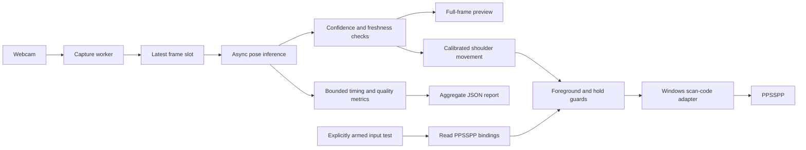

<h1 align="center">ShadowPad</h1>
<p align="center"><strong>A local computer-vision controller engine for PPSSPP.</strong><br>Upper-body tracking, guarded native inputs, and measurable real-time performance.</p>

<p align="center">
  <a href="https://github.com/chittranshsharma/Shadow-Pad/actions/workflows/ci.yml"></a>
  
  
  
  
</p>

ShadowPad explores playing a fighting game through body movement and arm gestures using a laptop webcam. Its foundation is a local processing engine: continuous capture, asynchronous pose estimation, confidence-aware tracking, native Windows input, and reproducible performance reports.

**Current release:** upper-body movement and four wrist-based attack gestures, a camera preview, and a separate button tester. The button tester and left/right/jump gestures have been confirmed working by the user. Duck and attack gestures need a live Tekken acceptance run.

## What works today

- **Upper-body tracking:** shoulders, elbows, and wrists; legs and hips are not required.
- **Full camera view:** mirrored windowed preview, no restrictive framing box, optional fullscreen with `F` and diagnostics with `Tab`.
- **Local AI inference:** MediaPipe Pose Landmarker Full, with Lite available for comparison.
- **Freshness-first processing:** one latest capture slot and at most one application-managed inference request in flight.
- **Honest tracking states:** hidden, out-of-frame, low-confidence, and stale observations stay distinguishable.
- **Native input tester:** reads PPSSPP keyboard bindings, explicitly arms one bounded action, and checks foreground focus.
- **Calibrated movement:** mirrored left/right lean, upper-body rise to jump, and dip to duck; shoulder-width normalization and hysteresis reduce dependence on distance and jitter.
- **Four attack gestures:** left/right fist thrusts forward or inward for Square/Triangle, left/right hand drives downward for Cross/Circle. Each triggers one short press and needs a return to guard before it can fire again.
- **Performance instrumentation:** timing percentiles, warmup exclusion, bounded sample retention, throughput, and aggregate JSON reports.
- **Automated verification:** camera-independent tests and a Windows GitHub Actions workflow.

## Tech stack

| Layer | Technology | Responsibility |
|---|---|---|
| Runtime | Python 3.14, standard library | Concurrency, CLI, configuration, reporting, tests |
| Camera and preview | OpenCV contrib | Windows capture backends, full-frame display, image conversion |
| AI / computer vision | MediaPipe Tasks, Pose Landmarker | Pretrained body-landmark estimation on the laptop |
| Image data | NumPy | Frame arrays and preview operations |
| Tracking engine | Confidence checks, monotonic timestamps | Joint reliability and stale-result rejection |
| Input adapter | `ctypes`, Win32 `SendInput` | Scan-code key-down/key-up and process-focus checks |
| Observability | Thread-safe bounded timing windows | P50/P95/P99, throughput, quality counts, JSON export |
| Verification | `unittest`, GitHub Actions | Deterministic behavior checks without a camera or game |

### Where the AI is

MediaPipe runs a pretrained pose-estimation model to infer body landmarks from camera images. ShadowPad then applies deterministic confidence and state rules to those results. It does not train a model, call an LLM, or require a paid inference API.

The backend is an **on-device processing engine**. Its concurrency, bounded buffering, input state machine, and instrumentation are the engineering focus. An HTTP service, database, and authentication layer are not needed for the current control loop.

## Architecture



Camera-only mode, the movement controller, and input tests have separate launchers. Movement input uses shoulders, so missing elbows do not block it. Landmarks are drawn on the exact frame that produced them, preserving alignment instead of overlaying old results on a newer image.

## Quick start

Requirements: Windows, a compatible **64-bit Python 3.14** installation, a webcam, and internet access for initial dependency/model downloads. The pinned package set has been verified locally on Python 3.14.8. PPSSPP and game files are not bundled.

```powershell
git clone https://github.com/chittranshsharma/Shadow-Pad.git
cd Shadow-Pad
powershell -NoProfile -ExecutionPolicy Bypass -File .\setup.ps1
```

Setup creates `.venv`, installs the pinned direct dependencies, and downloads the official Full model with a fixed SHA-256 check. The PowerShell flag applies to that invocation; it does not change the saved system policy.

### 1. Check the camera

Double-click **Start Tracking.cmd**, or run:

```powershell
.\.venv\Scripts\python.exe webcam_tracker.py
```

| Key | Action |
|---|---|
| `Tab` | Show/hide joint diagnostics |
| `F` | Toggle fullscreen |
| `Q` / `Esc` | Stop and release the webcam |

Sit naturally and use the whole camera image. If the image contains mostly ceiling and your shoulders are at the bottom, tilt the laptop screen slightly toward you so the lens aims lower. Keep hands above the table when testing wrists. No fixed box or guard pose is required. Enlarging the preview cannot widen the physical lens.

Green joints passed the visibility/presence threshold. If elbows are uncertain but shoulders and wrists are reliable, the status says exactly that; it does not manufacture a 6/6 result. Occlusion and a tight camera crop remain important limitations.

### 2. Test PPSSPP buttons

1. Launch PPSSPP and open **Tekken 6 → Practice mode**.
2. Double-click **Check PPSSPP Inputs.cmd**.
3. Choose **Left**, then click the PPSSPP game window within **three seconds**.
4. Verify a short movement and release. Repeat for **Right**.
5. Test **Square**, **Triangle**, **Cross**, and **Circle** individually.
6. Hold **Ctrl+Alt+P** briefly to cancel a countdown or hold. Each completed test returns paused.

The checker reads `controls.ini`; it does not rewrite emulator settings. The existing bindings used during development were:

| PSP action | Keyboard binding |
|---|---|
| Left / Right | Arrow keys |
| Square | `A` |
| Triangle | `S` |
| Cross | `Z` |
| Circle | `X` |

Inspect your saved bindings without sending an input:

```powershell
.\.venv\Scripts\python.exe input_check.py
```

Explicitly arm a single test:

```powershell
.\.venv\Scripts\python.exe input_check.py --button Left --run
.\.venv\Scripts\python.exe input_check.py --button Square --run
```

Directions default to a **0.5-second hold**, attacks to **0.12 seconds**. Delays accept 1–10 seconds and holds 0.03–1 second. `DONE` confirms input API completion and release. This checks individual inputs; use the movement controller below to play through body movement.

For a portable installation or a different memory stick:

```powershell
.\.venv\Scripts\python.exe input_check.py --controls 'D:\PPSSPP\memstick\PSP\SYSTEM\controls.ini'
```

Only supported keyboard bindings are used; gamepad bindings are ignored. Confirm any game-specific control overrides manually. Release physical keyboard/modifier keys before a test and run both apps at the same privilege level.

### 3. Play with movement gestures

1. Open Tekken Practice mode and double-click **Play ShadowPad.cmd**.
2. In the camera preview, press **C**, sit naturally, and hold still for about **two seconds**. Wait for **Calibrated**.
3. Press **A** in the camera preview, then click the PPSSPP game window during the five-second countdown. The preview will show **ACTIVE** when armed. Keep PPSSPP focused while playing.
4. Move using the mapping below. Returning toward neutral releases held directions.
5. Press **Ctrl+Alt+P** to pause (or to arm directly while PPSSPP is focused). Losing PPSSPP focus or reliable shoulder tracking also pauses and releases keys; use **A** in the preview to re-arm.

| Physical movement | Game input |
|---|---|
| Lean toward the left side of the mirrored camera view | Left held |
| Lean toward the right side | Right held |
| Raise your upper body above neutral | Up held for 0.30 seconds, then released |
| Dip your shoulders below neutral | Down held while dipped |
| Punch your left fist forward toward the camera, or inward, from chest-height guard | Square (left punch) |
| Punch your right fist forward toward the camera, or inward, from chest-height guard | Triangle (right punch) |
| Drive your left hand down from guard | Cross (left kick input) |
| Drive your right hand down from guard | Circle (right kick input) |
| Return toward centre | Movement released; jump can re-arm |

With an upper-body camera, the jump gesture is a rise/straighten motion; feet leaving the floor are not detected. Duck accepts either a shoulder dip or a clear head lowering when the head was visible during calibration. Up/Down are normal PSP directions, so Tekken's current mode, character state, and configured controls determine the resulting jump/crouch. Left/right can combine with a rise or dip. For attacks, start with both hands visible near chest height. The preview footer shows `hands 2/2` when both wrists have a usable guard. Punch forward toward the camera or inward, or drive the hand down for a kick button, then bring that hand back before repeating. Forward detection uses MediaPipe's estimated depth, which may vary by camera; an inward fist motion is the visible 2D alternative. The kick mappings are hand gestures for the PSP kick buttons; no leg tracking is involved. Elbows are not required. Keep the laptop camera stationary after calibration. Press **C** in the preview to recalibrate after changing position.

For smaller movements, increase sensitivity (allowed range 0.5–2):

```powershell
.\.venv\Scripts\python.exe webcam_tracker.py --control --sensitivity 1.5
```

The current activation offsets are 0.20 neutral shoulder-width units for horizontal movement, 0.28 upward for jump, and 0.17 downward for duck or 0.25 for head lowering, divided by sensitivity. Lower release thresholds provide hysteresis. Jump fires once per rise and re-arms after returning near neutral. Wrist gestures need 0.26 shoulder widths inward or 0.28 estimated depth units forward for a punch, or 0.30 shoulder widths downward for a kick input. Elbows and wrists are not prerequisites for movement; confident wrists are needed only for attacks.

## Measure performance

Close other camera applications before a run. A headless run measures the processing path without preview rendering:

```powershell
.\.venv\Scripts\python.exe webcam_tracker.py --headless --seconds 60 --warmup 15 --report reports/full-run-01.json
```

Compare Lite under the same setup:

```powershell
.\.venv\Scripts\python.exe download_model.py --variant lite
.\.venv\Scripts\python.exe webcam_tracker.py --model models/pose_landmarker_lite.task --headless --seconds 60 --warmup 15 --report reports/lite-run-01.json
```

Reports contain environment/model identifiers, aggregate timing statistics, throughput, and joint-reliability counts. They contain **no video frames or landmark coordinates**. Existing files are not overwritten. Generated reports are Git-ignored by default.

| Metric | What it tells you |
|---|---|
| Submit-to-result P50/P95/P99 | Time from application submission/preprocessing start to the model callback |
| Read-to-result P50/P95/P99 | Software age from completion of the camera read to the callback |
| Capture / completed-result FPS | Aggregate throughput over the measured capture-to-drain interval |
| Captured frames not submitted | Frames superseded intentionally or left during shutdown; not necessarily camera errors |
| Per-joint reliable-result counts | Tracking coverage across all completed results, including warmup |

The first 15 completed results are excluded from timing statistics by default. Timing samples retain the most recent 4,096 values; means cover all post-warmup timing samples, while percentiles cover that retained window. A run with no post-warmup samples reports unknown timing values, not zero latency.

**Current benchmark status:** instrumentation is implemented and tested. No controlled benchmark for the current Full-model release, gesture accuracy, or motion-to-visible-game latency is claimed. Earlier development smoke tests are not presented as release benchmarks.

See [the benchmark protocol](docs/PERFORMANCE.md) for repeatable comparisons and [the engine design](docs/ARCHITECTURE.md) for timing boundaries.

## Verify locally

```powershell
.\.venv\Scripts\python.exe -m unittest discover -s tests -v
.\.venv\Scripts\python.exe -m pip check
```

Tests cover confidence boundaries, stale results, framing advice, full-frame preview preservation, saved-key mapping, arming/countdown behavior, early release on focus loss, cancellation, uncertain input failure cleanup, percentile math, warmup accounting, bounded memory, concurrency, and report preservation.

CI runs these camera-independent checks on Windows/Python 3.14. It does not exercise a physical webcam, Windows input injection, or Tekken.

## Project layout

```text
webcam_tracker.py          Capture worker, async inference, preview, report integration
movement.py                Neutral calibration, movement gestures, continuous-input guards
tracking_quality.py        Confidence/freshness rules and honest tracking labels
ppsspp_input.py            Binding reader, bounded input state machine, Win32 adapter
input_check.py             Inspection-only / explicitly armed input-test CLI
performance.py             Bounded timing statistics and aggregate report export
download_model.py          Official model download and integrity verification
setup.ps1                  Local environment setup
tests/                     Camera-independent automated checks
docs/                      Architecture and benchmarking methodology
.github/workflows/ci.yml   Windows automated checks
```

## Roadmap

- [x] Local upper-body pose tracking and a minimal full-frame preview
- [x] Separate, guarded PPSSPP input-test harness
- [x] Bounded performance telemetry, report export, and automated checks
- [x] Confirm individual PPSSPP test inputs work (user acceptance)
- [x] Calibrate neutral shoulders; add left/right movement with a dead zone and hysteresis
- [x] Add upper-body rise/dip gestures for jump and duck
- [x] Confirm left/right/jump in Tekken (user acceptance)
- [x] Detect independent wrist strikes with one activation per ready/strike/return cycle
- [x] Add attack gestures to movement control with tracking-loss release behavior
- [ ] Validate duck and attack gestures in Tekken and tune sensitivity
- [ ] Measure gesture precision/recall, false activations, and motion-to-game latency

## Troubleshooting and limits

- **Camera unavailable:** close other camera apps; try `--camera 1` or `--backend msmf`. Check Windows camera permission yourself if required.
- **Elbows unreliable:** bring more of the torso into the image and avoid table/body occlusion. The Full model is available, but its elbow improvement in the development setup is not established.
- **Input cancelled:** PPSSPP must be foreground at key-down and throughout the short hold.
- **Input rejected:** check equal app privilege levels and the actual configured keyboard bindings.
- **Unexpected OpenCV errors:** install only `opencv-contrib-python` in the environment; do not also install `opencv-python` or a headless build.
- **No timing percentiles:** run longer than the configured warmup.

Input cleanup handles normal exits, exceptions, cancellation, and detected focus loss. `SendInput` uses global keyboard state: cleanup key-up events are global, a very small focus-check/input race is possible, and a forced process kill cannot guarantee release.

## Privacy and attribution

ShadowPad keeps camera images in memory and does not record or explicitly upload them. MediaPipe documents on-device input processing and possible performance/utilization telemetry; local inference is not a promise of zero library telemetry. Model downloads use Google's official host and fixed checksums. Emulator binaries, game images, model binaries, and local reports are not committed.

Built with [MediaPipe Pose Landmarker](https://developers.google.com/edge/mediapipe/solutions/vision/pose_landmarker/python), [OpenCV](https://docs.opencv.org/), and [Windows SendInput](https://learn.microsoft.com/en-us/windows/win32/api/winuser/nf-winuser-sendinput). Control integration targets [PPSSPP](https://www.ppsspp.org/docs/settings/controls/); saved key codes follow its [input definitions](https://github.com/hrydgard/ppsspp/blob/master/Common/Input/KeyCodes.h). This project is independent of PPSSPP and Tekken.
