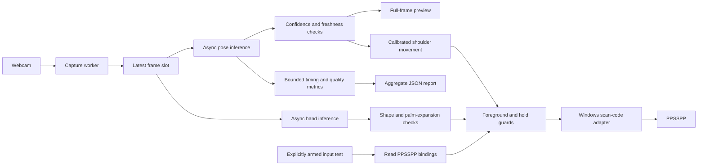

<h1 align="center">ShadowPad</h1>
<p align="center"><strong>A local computer-vision controller engine for PPSSPP.</strong><br>Upper-body tracking, guarded native inputs, and measurable real-time performance.</p>

<p align="center">
  <a href="https://github.com/chittranshsharma/Shadow-Pad/actions/workflows/ci.yml"></a>
  
  
  
  
</p>

ShadowPad explores playing a fighting game through body movement and arm gestures using a laptop webcam. Its foundation is a local processing engine: continuous capture, asynchronous pose estimation, confidence-aware tracking, native Windows input, and reproducible performance reports.

**Current release:** shoulder movement plus an experimental dedicated hand recognizer for straight forward attacks, a practice window that sends no game keys, and a separate button tester. The button tester and left/right/jump gestures are user-confirmed. The previous wrist-only attack detector was unreliable and has been replaced; the new hand detector still needs labeled live gameplay evaluation.

## What works today

- **Upper-body tracking:** shoulders, elbows, and wrists; legs and hips are not required.
- **Full camera view:** mirrored windowed preview, no restrictive framing box, optional fullscreen with `F` and diagnostics with `Tab`.
- **Local AI inference:** MediaPipe Pose Landmarker Full for the body and Gesture Recognizer for hand landmarks and fist/palm classification; Pose Lite is available for comparison.
- **Freshness-first processing:** one latest capture slot and at most one application-managed request in flight per model.
- **Honest tracking states:** hidden, out-of-frame, low-confidence, and stale observations stay distinguishable.
- **Native input tester:** reads PPSSPP keyboard bindings, explicitly arms one bounded action, and checks foreground focus.
- **Calibrated movement:** mirrored left/right lean, upper-body rise to jump, and dip to duck; shoulder-width normalization and hysteresis reduce dependence on distance and jitter.
- **Four attack gestures:** straight forward closed-fist pushes for Square/Triangle and open-palm pushes for Cross/Circle. Measured palm expansion, shape confidence, stable guard, motion progression, and return checks gate each short button press.
- **Practice first:** Test Gestures.cmd shows the detected hand shape, guard state, palm-size ratio, and attack counts through a keyboard adapter that cannot send native inputs.
- **Performance instrumentation:** timing percentiles, warmup exclusion, bounded sample retention, throughput, and aggregate JSON reports.
- **Automated verification:** camera-independent tests and a Windows GitHub Actions workflow.

## Tech stack

| Layer | Technology | Responsibility |
|---|---|---|
| Runtime | Python 3.14, standard library | Concurrency, CLI, configuration, reporting, tests |
| Camera and preview | OpenCV contrib | Windows capture backends, full-frame display, image conversion |
| AI / computer vision | MediaPipe Tasks, Pose Landmarker + Gesture Recognizer | Pretrained body landmarks, hand landmarks, fist/palm classification |
| Image data | NumPy | Frame arrays and preview operations |
| Tracking engine | Confidence checks, monotonic timestamps | Joint reliability and stale-result rejection |
| Input adapter | `ctypes`, Win32 `SendInput` | Scan-code key-down/key-up and process-focus checks |
| Observability | Thread-safe bounded timing windows | P50/P95/P99, throughput, quality counts, JSON export |
| Verification | `unittest`, GitHub Actions | Deterministic behavior checks without a camera or game |

### Where the AI is

MediaPipe runs pretrained body, hand-landmark, and hand-shape models on camera images. ShadowPad then applies deterministic motion and state rules to the results. The hand model classifies static fist/palm shapes; ShadowPad detects the forward motion. No custom model training or paid inference API is required.

The backend is an **on-device processing engine**. Its concurrency, bounded buffering, input state machine, and instrumentation are the engineering focus. An HTTP service, database, and authentication layer are not needed for the current control loop.

## Architecture



Camera-only mode, gesture practice, game control, and input tests have separate launchers. Movement uses shoulders; attacks use the dedicated hand model. Missing pose elbows do not block either. In hand mode, hand outlines are drawn on their matching inference frame; older pose skeletons are not drawn over that frame.

## Quick start

Requirements: Windows, a compatible **64-bit Python 3.14** installation, a webcam, and internet access for initial dependency/model downloads. The pinned package set has been verified locally on Python 3.14.8. PPSSPP and game files are not bundled.

```powershell
git clone https://github.com/chittranshsharma/Shadow-Pad.git
cd Shadow-Pad
powershell -NoProfile -ExecutionPolicy Bypass -File .\setup.ps1
```

Setup creates `.venv`, installs the pinned direct dependencies, and downloads the official Full pose and Gesture Recognizer models with fixed SHA-256 checks. The PowerShell flag applies to that invocation; it does not change the saved system policy. Existing installations can add the hand model with `download_model.py --variant hands`; both gesture launchers also download it if missing.

### 1. Check the camera

Double-click **Start Tracking.cmd**, or run:

```powershell
.\.venv\Scripts\python.exe webcam_tracker.py
```

| Key | Action |
|---|---|
| `Tab` | Show/hide joint diagnostics |
| `F` | Toggle fullscreen |
| `Q` / `Esc` | Stop and release the webcam |

Sit naturally and use the whole camera image. If the image contains mostly ceiling and your shoulders are at the bottom, tilt the laptop screen slightly toward you so the lens aims lower. Keep hands above the table when testing wrists. No fixed box or guard pose is required. Enlarging the preview cannot widen the physical lens.

Green joints passed the visibility/presence threshold. If elbows are uncertain but shoulders and wrists are reliable, the status says exactly that; it does not manufacture a 6/6 result. Occlusion and a tight camera crop remain important limitations.

### 2. Test PPSSPP buttons

1. Launch PPSSPP and open **Tekken 6 → Practice mode**.
2. Double-click **Check PPSSPP Inputs.cmd**.
3. Choose **Left**, then click the PPSSPP game window within **three seconds**.
4. Verify a short movement and release. Repeat for **Right**.
5. Test **Square**, **Triangle**, **Cross**, and **Circle** individually.
6. Hold **Ctrl+Alt+P** briefly to cancel a countdown or hold. Each completed test returns paused.

The checker reads `controls.ini`; it does not rewrite emulator settings. The existing bindings used during development were:

| PSP action | Keyboard binding |
|---|---|
| Left / Right | Arrow keys |
| Square | `A` |
| Triangle | `S` |
| Cross | `Z` |
| Circle | `X` |

Inspect your saved bindings without sending an input:

```powershell
.\.venv\Scripts\python.exe input_check.py
```

Explicitly arm a single test:

```powershell
.\.venv\Scripts\python.exe input_check.py --button Left --run
.\.venv\Scripts\python.exe input_check.py --button Square --run
```

Directions default to a **0.5-second hold**, attacks to **0.12 seconds**. Delays accept 1–10 seconds and holds 0.03–1 second. `DONE` confirms input API completion and release. This checks individual inputs; use the movement controller below to play through body movement.

For a portable installation or a different memory stick:

```powershell
.\.venv\Scripts\python.exe input_check.py --controls 'D:\PPSSPP\memstick\PSP\SYSTEM\controls.ini'
```

Only supported keyboard bindings are used; gamepad bindings are ignored. Confirm any game-specific control overrides manually. Release physical keyboard/modifier keys before a test and run both apps at the same privilege level.

### 3. Check hand gestures without game inputs

1. Open **Test Gestures.cmd**. This mode cannot send desktop keyboard events.
2. Press **C**, sit naturally with your head and shoulders visible, and hold still for about two seconds.
3. Press **A** to start practice. Hold one closed fist in a comfortable starting position, fully in view, with knuckles facing the camera until its state says **ready**. There is no chest-height gate or framing box. Learning a hand guard takes roughly half a second of stable observations.
4. Punch straight toward the camera, keeping the same hand orientation, then retract to the starting guard. The matching Square/Triangle counter should increase once.
5. For a kick button, open that hand, hold the palm facing the camera until **ready**, push it straight forward, and retract. The matching Cross/Circle counter should increase once.
6. Keep hands still for 20 seconds; counters should remain unchanged. Check ten deliberate attempts per action before using game control. Practice results are recognition events, not proof of Tekken response.

The preview shows the actual hand-shape label and score, each hand's state and blocking reason, and its size relative to guard (`1.00x` at guard). The score is model confidence, not measured recognition accuracy, and does not need to reach 100%. A five-sample temporal check establishes confidence instead of demanding one high score on every frame. **H** relearns hand guards without recalibrating shoulders; **A** pauses/resumes practice. The left/right labels refer to your anatomical hands, using mirrored hand-model input as in Google's official example. The kick controls are deliberate hand proxies because the laptop view does not include your legs.

### 4. Play in PPSSPP

1. Open Tekken Practice mode and double-click **Play ShadowPad.cmd**.
2. In the camera preview, press **C**, sit naturally, and hold still for about **two seconds**. Wait for **Calibrated**.
3. Press **A** in the camera preview, then click the PPSSPP game window during the five-second countdown. The preview will show **ACTIVE** when armed. Keep PPSSPP focused while playing.
4. Move using the mapping below. Returning toward neutral releases held directions.
5. Press **Ctrl+Alt+P** to pause (or to arm directly while PPSSPP is focused). Losing PPSSPP focus pauses and releases keys. Brief shoulder-tracking gaps release keys and recover automatically; they do not require recalibration.

| Physical movement | Game input |
|---|---|
| Lean toward the left side of the mirrored camera view | Left held |
| Lean toward the right side | Right held |
| Raise your upper body above neutral | Up held for 0.30 seconds, then released |
| Dip your shoulders below neutral | Down held while dipped |
| Left closed-fist push straight toward the camera, then retract | Square (left punch) |
| Right closed-fist push straight toward the camera, then retract | Triangle (right punch) |
| Left open-palm push straight toward the camera, then retract | Cross (left kick input) |
| Right open-palm push straight toward the camera, then retract | Circle (right kick input) |
| Return toward centre | Movement released; jump can re-arm |

With an upper-body camera, jump is a rise/straighten motion; feet leaving the floor are not detected. Duck accepts a shoulder dip or a clear head lowering when the head was visible during calibration. Up/Down are PSP directions, so Tekken's current state and configured controls determine the resulting jump/crouch. For attacks, keep the whole hand in frame and hold the same fist/palm orientation while pushing. Rotation, tiny hands, blur, occlusion, or unreliable shape classification can block recognition. Opening a fist learns a new palm guard and does not itself trigger a kick. Keep the camera stationary; use **C** after changing camera/seating position and **H** to relearn hands. **Tab** shows hand states and counters in game mode.

For smaller movements, increase sensitivity (allowed range 0.5–2):

```powershell
.\.venv\Scripts\python.exe webcam_tracker.py --control --sensitivity 1.5
```

Movement sensitivity affects shoulders only. Attacks use a separate conservative detector: a three-result median filters palm dimensions; a stable guard establishes scale; at least two growth steps, at least 35% combined expansion, growth in both palm dimensions, and a short motion window are required. Pose depth is unused. A strike sends one 120 ms press and needs retraction plus a cooldown before it can repeat. This is experimental geometry on top of pretrained hand classification, not a trained punch detector.

## Measure performance

Close other camera applications before a run. A headless run measures the processing path without preview rendering:

```powershell
.\.venv\Scripts\python.exe webcam_tracker.py --headless --seconds 60 --warmup 15 --report reports/full-run-01.json
```

Compare Lite under the same setup:

```powershell
.\.venv\Scripts\python.exe download_model.py --variant lite
.\.venv\Scripts\python.exe webcam_tracker.py --model models/pose_landmarker_lite.task --headless --seconds 60 --warmup 15 --report reports/lite-run-01.json
```

Reports contain environment/model identifiers, aggregate timing statistics, throughput, and joint-reliability counts. They contain **no video frames or landmark coordinates**. Existing files are not overwritten. Generated reports are Git-ignored by default.

To exercise both models without game inputs, add `--practice --headless --seconds 60 --report reports/both-models-01.json`. This headless diagnostic stays paused and cannot evaluate gesture recognition without an interactive calibration. `hand_pipeline` reports all hand callbacks and their submission-to-callback timing, including warmup; the pose pipeline's warmup exclusion does not apply to hand timings.

| Metric | What it tells you |
|---|---|
| Submit-to-result P50/P95/P99 | Time from application submission/preprocessing start to the model callback |
| Read-to-result P50/P95/P99 | Software age from completion of the camera read to the callback |
| Capture / completed-result FPS | Aggregate throughput over the measured capture-to-drain interval |
| Captured frames not submitted | Frames superseded intentionally or left during shutdown; not necessarily camera errors |
| Per-joint reliable-result counts | Tracking coverage across all completed results, including warmup |

The first 15 completed results are excluded from timing statistics by default. Timing samples retain the most recent 4,096 values; means cover all post-warmup timing samples, while percentiles cover that retained window. A run with no post-warmup samples reports unknown timing values, not zero latency.

**Current benchmark status:** instrumentation is implemented and tested. No controlled benchmark for the current Full-model release, gesture accuracy, or motion-to-visible-game latency is claimed. Earlier development smoke tests are not presented as release benchmarks.

See [the benchmark protocol](docs/PERFORMANCE.md) for repeatable comparisons and [the engine design](docs/ARCHITECTURE.md) for timing boundaries.

## Verify locally

```powershell
.\.venv\Scripts\python.exe -m unittest discover -s tests -v
.\.venv\Scripts\python.exe -m pip check
```

Tests cover confidence boundaries, stale results, framing advice, full-frame preview preservation, saved-key mapping, arming/countdown behavior, early release on focus loss, cancellation, uncertain input failure cleanup, percentile math, warmup accounting, bounded memory, concurrency, and report preservation.

CI runs these camera-independent checks on Windows/Python 3.14. It does not exercise a physical webcam, Windows input injection, or Tekken.

## Project layout

```text
webcam_tracker.py          Capture worker, async inference, preview, report integration
movement.py                Neutral calibration, movement gestures, continuous-input guards
attacks.py                 Shape-gated forward motion, guard/strike/return states
hand_tracking.py           Dedicated local hand model, geometry extraction, async results
tracking_quality.py        Confidence/freshness rules and honest tracking labels
ppsspp_input.py            Binding reader, bounded input state machine, Win32 adapter
input_check.py             Inspection-only / explicitly armed input-test CLI
performance.py             Bounded timing statistics and aggregate report export
download_model.py          Official model download and integrity verification
setup.ps1                  Local environment setup
tests/                     Camera-independent automated checks
docs/                      Architecture and benchmarking methodology
.github/workflows/ci.yml   Windows automated checks
```

## Roadmap

- [x] Local upper-body pose tracking and a minimal full-frame preview
- [x] Separate, guarded PPSSPP input-test harness
- [x] Bounded performance telemetry, report export, and automated checks
- [x] Confirm individual PPSSPP test inputs work (user acceptance)
- [x] Calibrate neutral shoulders; add left/right movement with a dead zone and hysteresis
- [x] Add upper-body rise/dip gestures for jump and duck
- [x] Confirm left/right/jump in Tekken (user acceptance)
- [x] Replace unreliable pose-wrist attacks with dedicated hand classification and palm-expansion checks
- [x] Add gesture practice with no native input and visible per-action counters
- [x] Add attack gestures to movement control with tracking-loss release behavior
- [ ] Validate duck and attack gestures in Tekken and tune sensitivity
- [ ] Measure gesture precision/recall, false activations, and motion-to-game latency

## Troubleshooting and limits

- **Camera unavailable:** close other camera apps; try `--camera 1` or `--backend msmf`. Check Windows camera permission yourself if required.
- **Elbows unreliable:** bring more of the torso into the image and avoid table/body occlusion. The Full model is available, but its elbow improvement in the development setup is not established.
- **Attacks do not fire:** use Test Gestures.cmd and inspect the hand label/state. Show a complete fist/palm near chest height until **ready**, keep its orientation, then push toward the lens and retract. If it remains **return**, move back to guard; H resets hand guards if your posture changed. A hand absent from the image cannot be detected.
- **Unexpected attacks:** practice at rest and inspect which counter changes. Classification and geometric motion remain experimental; no measured live accuracy or false-activation rate is claimed. Report the hand label, state, and counter affected so the failure can be reproduced.
- **A brief tracking gap:** held inputs release immediately and resume after two good shoulder results. Keep PPSSPP focused; changing focus still pauses the controller.
- **Input cancelled:** PPSSPP must be foreground at key-down and throughout the short hold.
- **Input rejected:** check equal app privilege levels and the actual configured keyboard bindings.
- **Unexpected OpenCV errors:** install only `opencv-contrib-python` in the environment; do not also install `opencv-python` or a headless build.
- **No timing percentiles:** run longer than the configured warmup.

Input cleanup handles normal exits, exceptions, cancellation, and detected focus loss. `SendInput` uses global keyboard state: cleanup key-up events are global, a very small focus-check/input race is possible, and a forced process kill cannot guarantee release.

## Privacy and attribution

ShadowPad keeps camera images in memory and does not record or explicitly upload them. MediaPipe documents on-device input processing and possible performance/utilization telemetry; local inference is not a promise of zero library telemetry. Model downloads use Google's official host and fixed checksums. Emulator binaries, game images, model binaries, and local reports are not committed.

Built with [MediaPipe Pose Landmarker](https://developers.google.com/edge/mediapipe/solutions/vision/pose_landmarker/python), [Gesture Recognizer](https://developers.google.com/edge/mediapipe/solutions/vision/gesture_recognizer/python), [OpenCV](https://docs.opencv.org/), and [Windows SendInput](https://learn.microsoft.com/en-us/windows/win32/api/winuser/nf-winuser-sendinput). Control integration targets [PPSSPP](https://www.ppsspp.org/docs/settings/controls/); saved key codes follow its [input definitions](https://github.com/hrydgard/ppsspp/blob/master/Common/Input/KeyCodes.h). This project is independent of PPSSPP and Tekken.
