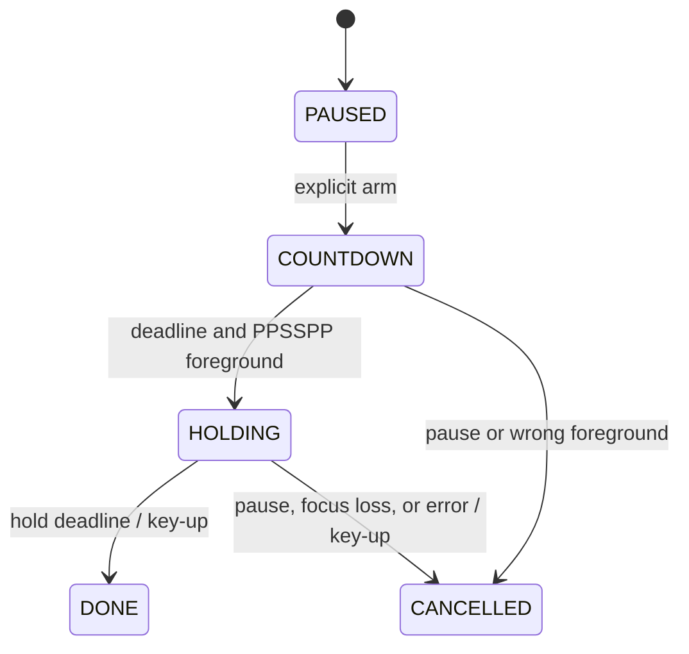

# Engine design

ShadowPad is a Windows desktop computer-vision prototype. Its processing engine and input adapter are independent of the preview layout. There is no HTTP service or database in the current implementation.

## Data path and concurrency

1. A capture worker continuously calls OpenCV `read()` and replaces one latest-frame slot under a lock. There is no growing camera-frame queue.
2. The main loop submits only when the pose tracker has no application-managed request in flight. Intermediate captures can be superseded intentionally.
3. The tracker sends RGB data through MediaPipe's asynchronous Tasks API. Resizing preserves the complete image and aspect ratio; no framing rectangle restricts inference.
4. The callback pairs normalized landmarks with the original full camera frame. It records metrics independently of whether the main loop consumes every result.
5. The main loop rejects stale observations, mirrors the matching frame for display, and renders a minimal status. Diagnostics are optional.

Capture and inference buffers are bounded. The timing collector retains at most 4,096 samples per timing series; counters and cumulative sums remain constant-size. One processed frame and a pending frame can coexist with the latest capture. MediaPipe/OpenCV internal buffers and native allocations are outside these application-level bounds.

## Confidence and coordinates

Both presence and visibility must pass the configured threshold, default 0.6, and coordinates must be finite and inside the image. Required upper-body indices are 11–16. Hips and legs do not affect the quality decision. Results older than 500 ms are not reliable observations.

Inference uses the original image. Only display coordinates are mirrored, preserving anatomical left/right labels. Shoulders and wrists are reported separately when elbows are uncertain. A geometric elbow guess is not accepted as reliable detection.

## Input state machine

The checker reads supported device-1 keyboard bindings from PPSSPP's controls file and ignores gamepad bindings. A Win32 process query checks the foreground executable before key-down; focus is checked again during the hold. Physical key/modifier interference blocks the action. Tests hold for at most one second and finish paused.

Cleanup attempts key-up even after an uncertain input failure. Windows keyboard state is global, so cleanup releases are global. Foreground queries and `SendInput` are not atomic; forced kills and driver/process stalls also limit cleanup guarantees. Native delivery and visible game response require separate manual checks.

## Calibrated movement

`movement.py` samples stable shoulder midpoints for two seconds and normalizes offsets by neutral shoulder width. Horizontal and duck controls use different engage/release thresholds. A rise produces one 300 ms Up hold; returning near neutral re-arms it. Left/right and vertical actions can combine. Missing elbows do not gate these shoulder-based controls.

The controller starts paused, calibrates with C in the preview, and arms with Ctrl+Alt+P while PPSSPP is foreground. A hotkey rising-edge check prevents repeated toggles while held. Modifier keys suppress injection until released. Every new result updates the desired key set; a separate tick reconciles releases and presses and expires the Up pulse even between model callbacks. Foreground changes, invalid shoulders, or more than 250 ms without a fresh shoulder observation pause control and release held keys.

## Timing boundaries

Durations use a monotonic clock. Camera timestamps are recorded after `read()` returns and quantized to milliseconds for MediaPipe. Submit-to-result starts before RGB conversion/optional resizing and ends at callback entry; it is not isolated neural-network execution time. Read-to-result includes scheduling and preprocessing after camera delivery.

The callback collector counts every completed result. The main loop's observed-result counter can miss results while rendering. Reports stop capture and drain pending inference before taking final counters. Throughput spans capture startup through that drain, including camera warmup and shutdown. Timing warmup is a separate result-count exclusion.

Current metrics do not measure camera exposure, physical gesture onset, labeled gesture accuracy, emulator response, or display latency. JSON reports include model/dependency identifiers, configuration, and basic hardware details. They contain no frames, coordinates, hostnames, usernames, or absolute model paths.

## Verification

Camera-open/read errors, stale results, inference stalls, invalid CLI settings, unsupported bindings, focus loss, and input failures have explicit paths. Resource cleanup uses `finally`. Reports refuse to overwrite previous runs.

Tests use deterministic joints and a fake keyboard backend; they also cover timing math and concurrency. Hardware quality, native input, and visible game behavior remain distinct manual checks.
