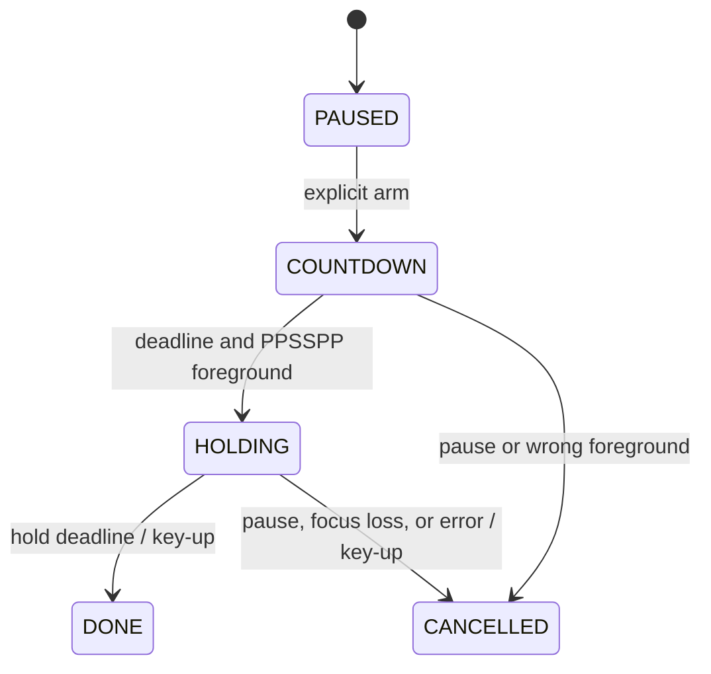

# Engine design

ShadowPad is a Windows desktop computer-vision prototype. Its processing engine and input adapter are independent of the preview layout. There is no HTTP service or database in the current implementation.

## Data path and concurrency

1. A capture worker continuously calls OpenCV `read()` and replaces one latest-frame slot under a lock. There is no growing camera-frame queue.
2. The main loop submits independently to pose and hand trackers, each with at most one application-managed request in flight. Intermediate captures can be superseded intentionally.
3. Pose inference uses MediaPipe Pose Landmarker; hand inference uses Gesture Recognizer for 21 hand landmarks, handedness, and static fist/palm labels. RGB conversion preserves the complete frame.
4. Each callback pairs its result with the exact input frame and records aggregate timing metrics.
5. The main loop rejects stale observations, evaluates body movement and hand motion, and reconciles desired keys. In hand mode, display uses the matching hand-model frame and does not overlay an older pose skeleton.

Capture and inference buffers are bounded. The timing collector retains at most 4,096 samples per timing series; counters and cumulative sums remain constant-size. One processed frame and a pending frame can coexist with the latest capture. MediaPipe/OpenCV internal buffers and native allocations are outside these application-level bounds.

## Confidence and coordinates

Both presence and visibility must pass the configured threshold, default 0.6, and coordinates must be finite and inside the image. Required upper-body indices are 11–16. Hips and legs do not affect the quality decision. Results older than 500 ms are not reliable observations.

Pose inference uses the original image; pose display coordinates are mirrored. Hand inference uses mirrored input, following Google's sample handedness convention. Hand landmarks must be finite and wholly in-frame; handedness must reach 0.7. Model fist/palm observations need a per-frame score of at least 0.5. Guard learning requires at least five observations, with at least 60% supported by either a score of 0.6 or definite finger geometry. The model's hand presence/detection/tracking thresholds remain 0.6. Classification scores are not measured recognition accuracy or a substitute for presence confidence. Pose elbows remain optional for control.

The canned classifier returned `None` for a visible boxing fist during live testing. A fallback checks hand-world finger geometry: at least three folded fingers with no extended finger identify a fist; at least three extended fingers with no folded finger identify a palm. PIP angles and fingertip-to-knuckle reach are invariant to hand rotation. This is static shape evidence; forward motion still uses image-space palm expansion. Geometry-derived shapes carry no probability and are labeled as finger curl in the preview. A pointing finger does not qualify as either shape.

## Input state machine

The checker reads supported device-1 keyboard bindings from PPSSPP's controls file and ignores gamepad bindings. A Win32 process query checks the foreground executable before key-down; focus is checked again during the hold. Physical key/modifier interference blocks the action. Tests hold for at most one second and finish paused.

Cleanup attempts key-up even after an uncertain input failure. Windows keyboard state is global, so cleanup releases are global. Foreground queries and `SendInput` are not atomic; forced kills and driver/process stalls also limit cleanup guarantees. Native delivery and visible game response require separate manual checks.

## Calibrated movement

`movement.py` samples stable shoulder midpoints for two seconds and normalizes offsets by neutral shoulder width. It also samples a visible head to support seated ducking. Horizontal and duck controls use different engage/release thresholds. A rise produces one 300 ms Up hold; returning near neutral re-arms it. Left/right and vertical actions can combine. Missing elbows do not gate these shoulder-based controls.

The prior pose-wrist attack heuristic was removed after repeated false activations and missed strikes in live use. `attacks.py` now consumes dedicated hand observations. Fist pushes map to punch buttons; palm pushes map to kick buttons. Palm width uses index-to-pinky knuckles and palm length uses wrist-to-middle knuckle; distances account for image aspect ratio. A three-result median filters dimensions and position. At least five stable observations over 300 ms learn a guard, using median deviation and trend checks instead of rejecting the whole window for one outlier. Short confidence/body gaps preserve guard learning; prolonged gaps reject continuity. Any fully visible hand position is allowed.

Palm size alone did not respond reliably to live punches, so an alternative projected-motion path was added. Trigger progress is the maximum of valid palm expansion, upward hand travel, and sideways travel relative to the torso. Thresholds are 35% expansion, 0.22 shoulder widths upward, or 0.30 sideways. Downward hand travel suppresses strikes. Within 800 ms, progressive motion or two confirmed endpoint results must reach the threshold. Pose depth is unused.

Each recognized strike requests one 120 ms button pulse. Retraction within 0.12 shoulder widths of guard and a 300 ms cooldown prevent repeats, including when a projected strike is held extended. Opening a fist relearns the hand-shape baseline; lowering a hand cannot trigger a kick. Missing/uncertain/duplicate hands interrupt their state and require return before another attack. Large position jumps, stale timestamps, and torso-width changes reject continuity. These rules reduce known failure modes in deterministic tests; real camera accuracy remains to be measured.

The controller starts paused, calibrates with C in the preview, and starts a five-second arm countdown with A so the user can focus PPSSPP. Ctrl+Alt+P also arms directly while PPSSPP is foreground or pauses an active session. A hotkey rising-edge check prevents repeated toggles while held. Modifier keys suppress injection until released. Every new result updates the desired key set; a separate tick reconciles releases and presses and expires the Up pulse even between model callbacks. Foreground loss pauses control. Invalid shoulders or more than 600 ms without a fresh shoulder observation release all keys, then two good results restore control automatically without recalibration. The preview is windowed by default so it does not cover the game during arming.

Hand events require both pose and hand observations younger than 300 ms. Stale or missing hand observations clear attack pulses while shoulder movement can continue. Test Gestures.cmd selects `PracticeKeyboard`, which has no native API calls; it runs the same calibration, motion detector, pulse, and counter logic. C calibrates and starts practice automatically; A pauses/resumes it, H resets only hand guards, and no PPSSPP focus is needed in practice. Game mode still requires explicit arming after calibration.

## Timing boundaries

Durations use a monotonic clock. Camera timestamps are recorded after `read()` returns and quantized to milliseconds for MediaPipe. Submit-to-result starts before RGB conversion/optional resizing and ends at callback entry; it is not isolated neural-network execution time. Read-to-result includes scheduling and preprocessing after camera delivery.

The callback collector counts every completed result. The main loop's observed-result counter can miss results while rendering. Reports stop capture and drain pending inference before taking final counters. Throughput spans capture startup through that drain, including camera warmup and shutdown. Timing warmup is a separate result-count exclusion.

`hand_pipeline.submit_to_result` includes all hand callbacks from preprocessing start through callback extraction, including warmup. It is reported separately from pose timing. The hand model name/hash and recognition event counts are included; event counts do not prove delivery or game response.

Current metrics do not measure camera exposure, physical gesture onset, labeled gesture accuracy, emulator response, or display latency. JSON reports include model/dependency identifiers, configuration, and basic hardware details. They contain no frames, coordinates, hostnames, usernames, or absolute model paths.

## Verification

Camera-open/read errors, stale results, inference stalls, invalid CLI settings, unsupported bindings, focus loss, and input failures have explicit paths. Resource cleanup uses `finally`. Reports refuse to overwrite previous runs.

Tests use deterministic joints and a fake keyboard backend; they also cover timing math and concurrency. Hardware quality, native input, and visible game behavior remain distinct manual checks.
